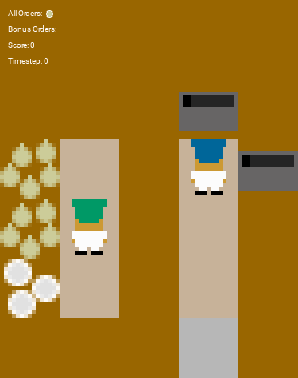
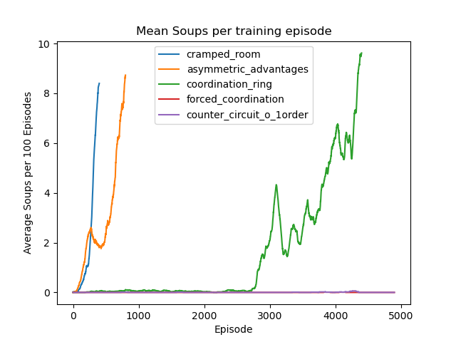
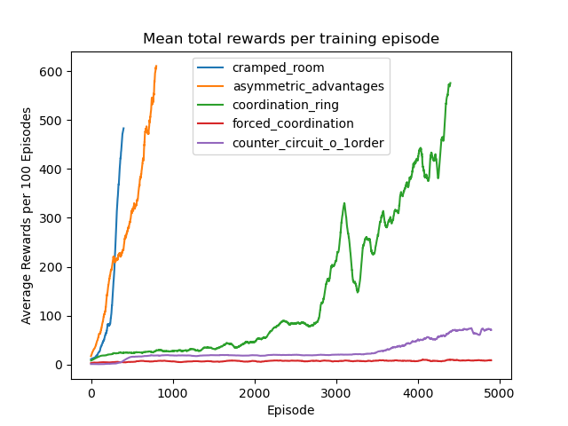
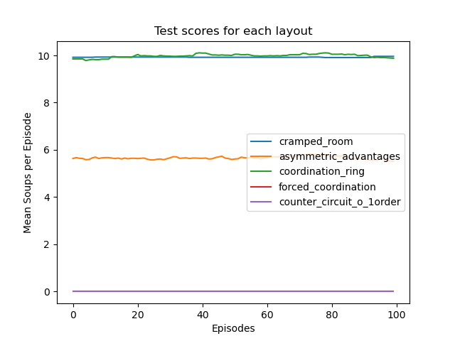
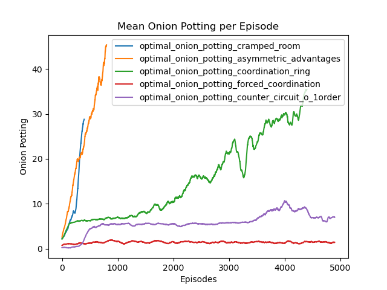
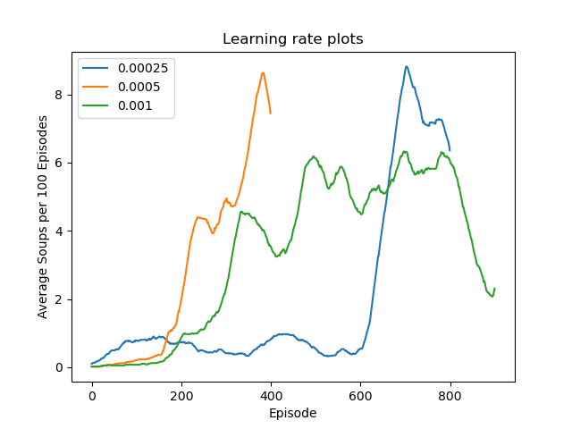
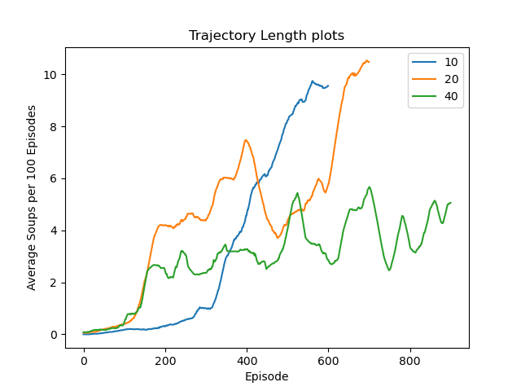

# Cooperative Overcooked with Multi-Agent PPO

Two independent PPO agents (actor–critic) learning to cook and deliver onion soup together in the [Overcooked-AI](https://github.com/HumanCompatibleAI/overcooked_ai) environment, trained in parallel across 16 worker processes.

<p align="center">
  
  <br>
  <em>One 400-step episode on <code>forced_coordination</code>, the hardest layout and one the agents did not solve (see <a href="#why-two-layouts-fail">Why two layouts fail</a>).</em>
</p>

## Results at a glance

| Layout | Training episodes | Training score (avg soups, last 100 episodes) | Test score (avg soups) | Target (≥ 7) |
|---|---:|---:|---:|:---:|
| `cramped_room` | 500 | 8.4 | ~9.9 | ✅ |
| `coordination_ring` | 4,500 | 9.7 | ~10.0 | ✅ |
| `asymmetric_advantages` | 900 | 8.7 | ~5.6 | ❌ |
| `counter_circuit_o_1order` | 5,000 | 0.0 | 0.0 | ❌ |
| `forced_coordination` | 5,000 | 0.0 | 0.0 | ❌ |

Training stops when the 100-episode average reaches 8 soups, or after 5,000 episodes. Test scores are 100-episode averages over 200 test episodes, with actions sampled from the learned policy.

## The problem

Two chefs share a kitchen. A soup needs three onions placed in a pot. It then cooks for 20 timesteps, gets put in a dish, and must be carried to the serving window. Each delivered soup is worth **+20**. An episode lasts **400 timesteps**, and the goal is to average **at least 7 soups per episode** on every layout, using **one set of hyperparameters and reward shaping for all five layouts**.

The five layouts test different kinds of cooperation:

- **`cramped_room`**: a small shared space, where the chefs mostly need to stay out of each other's way.
- **`asymmetric_advantages`**: each chef is closer to different resources.
- **`coordination_ring`**: a loop the two chefs must move around without blocking each other.
- **`forced_coordination`**: the chefs are separated by a counter. One side has the onions and dishes, the other has the pot and serving window, so items **must** be passed across the counter.
- **`counter_circuit_o_1order`**: long distances between ingredients, pots and serving window, which reward chefs who pass items over the middle counter.

## Approach

### Independent actor–critic PPO
Each chef has its **own actor network and its own critic network**. Each sees only its own 96-number observation of the kitchen, the built-in `featurize_state_mdp` features.

| Network | Layers | Output |
|---|---|---|
| Actor | 96 → 128 → 128 → 6 (ReLU) | Softmax over the 6 actions |
| Critic | 96 → 128 → 128 → 1 (ReLU) | State value V(s) |

Weights are initialised orthogonally. The actor's final layer starts with a small scale (std = 0.01) so early policies are close to uniform.

The networks are trained with **Proximal Policy Optimization (PPO)** ([Schulman et al., 2017](https://arxiv.org/abs/1707.06347)):

- **Advantages** come from Generalized Advantage Estimation (GAE):
  `A_t = δ_t + (γλ)δ_{t+1} + …`, where `δ_t = r_t + γV(s_{t+1}) − V(s_t)`
- **Actor loss** is the clipped surrogate objective:
  `L_clip = E[min(r_t(θ)·A_t, clip(r_t(θ), 1−ε, 1+ε)·A_t)]`
- **Critic loss** is `0.5 · (A_t + V_old(s_t) − V(s_t))²`
- **Total loss** is `−L_clip + c₁·L_critic − c₂·Entropy`, with c₁ = 0.5 and c₂ = 0.01. The entropy term keeps the agents exploring.
- Gradients are clipped to a norm of 0.5 for both networks.

### Reward shaping
The +20 for a delivered soup is too rare to learn from at the start, so each chef also gets small rewards for useful intermediate steps, using the environment's built-in shaping:

| Event | Reward |
|---|---:|
| Placing an ingredient in a pot | +3 |
| Picking up a dish | +3 |
| Picking up a cooked soup | +5 |
| Delivering a soup (shared by both chefs) | +20 |

Shaped rewards are credited to the chef who earned them. Because the environment randomly swaps which player each agent controls at every reset, the code maps the shaped rewards back to the right agent each step.

### Parallel training
Training runs **16 worker processes at once**. Every worker plays its own episodes and updates the **same shared networks** (`torch.multiprocessing`, Hogwild-style), which speeds up data collection considerably.

### Hyperparameters

Chosen on `cramped_room` and then used unchanged for all layouts:

| Parameter | Value |
|---|---|
| Learning rate (actor and critic, Adam) | 5 × 10⁻⁴ |
| Discount γ | 0.99 |
| GAE λ | 0.95 |
| PPO clip ε | 0.2 |
| Steps per update (N) | 10 |
| Mini-batch size | 5 |
| Passes over each batch | 2 |
| Entropy coefficient | 0.01 |
| Worker processes | 16 |

## Results

### Learning curves



`cramped_room` and `asymmetric_advantages` learn within the first 1,000 episodes. `coordination_ring` produces almost nothing for about 2,700 episodes, then improves rapidly once the chefs start completing soups regularly. Each delivery reinforces the whole chain of steps that led to it.



The total-reward curves follow the same pattern. `counter_circuit_o_1order` shows a slow but steady rise from shaped rewards even though it never delivers a soup.

### Test performance



At test time, `cramped_room` and `coordination_ring` average about 10 soups per episode. `asymmetric_advantages` drops from 8.7 in training to about 5.6. One likely cause is that test actions are sampled from the policy rather than taken greedily, so its remaining randomness costs soups.

### What the agents actually learned



Counting correct onion placements (`optimal_onion_potting`) shows *how far* the agents get through the recipe. On `counter_circuit_o_1order` they do learn to fill pots, reaching 7 to 10 placements per episode, but never finish the dish-and-deliver part. On `forced_coordination` they barely place any onions at all.

### Hyperparameter experiments

| Learning rate | Steps per update (N) |
|---|---|
|  |  |

Both experiments were run on `cramped_room`. A learning rate of **5 × 10⁻⁴** reached a score of 8 fastest (about 400 episodes). 2.5 × 10⁻⁴ got there much later, and 10⁻³ was unstable. Shorter update windows of **10–20 steps** learned well, while 40 steps plateaued around 5.

## Why two layouts fail

The reward shaping rewards *individual* steps: picking up, placing in a pot, picking up a soup. On `forced_coordination`, the chef who can reach the onions **cannot reach the pot**. The only way to score is for one chef to put an onion on the counter so the other can pick it up, and nothing in the reward signal encourages that. The animation at the top shows this: the left chef has all the onions and dishes, the right chef has the pot and the serving window, and no soup is ever made.

`counter_circuit_o_1order` has a softer version of the same problem: long walking distances make passing items over the counter far more efficient than solo trips, and that behaviour is never directly rewarded.

## Limitations and next steps

- **Reward passing items.** Add shaped rewards for putting an item on a counter the other chef can reach. This is the most direct fix for `forced_coordination`.
- **Use a shared critic.** A critic that sees both chefs' observations (the MAPPO approach) gives each agent a better sense of how its teammate affects the outcome.
- **Use longer, cleaner updates.** Updates currently use only 10 steps, in mini-batches of 5. Longer rollouts, larger mini-batches, normalised advantages, and estimating the value after the last step of each rollout should make learning more stable.
- **Phase out reward shaping over time** so the agents end up optimising the real objective, delivered soups.
- **Test greedily.** Choose the highest-probability action at test time (`test(..., sample=False)`) to reduce the training-to-test drop seen on `asymmetric_advantages`.
- **Make runs reproducible.** Set random seeds. With 16 workers updating shared networks without locks, runs currently are not exactly repeatable.

## Running the code

**Requirements:** Python 3.10. Clone the repo and install the dependencies, including Overcooked-AI from GitHub:

```bash
git clone https://github.com/smit-r/RL-multiagent-ppo.git
cd RL-multiagent-ppo
pip install -r requirements.txt
```

The code uses the older `gym` interface, where `env.step` returns four values, so `requirements.txt` pins `gym<0.26`.

**Train** on one layout, using 16 processes by default:

```bash
python scratch.py --layout cramped_room
```

Checkpoints are written to the repo root every 100 episodes (counted across all workers) as `<layout>_actor_ppo_mp_128{0,1}.pth` and `<layout>_critic_ppo_mp_128{0,1}.pth`, one actor and one critic per agent. To test them, move them into `models/`, replacing the provided weights.

**Test** the saved models in `models/` for 200 episodes:

```bash
python scratch.py --layout cramped_room --test_layout
```

Valid layouts are `cramped_room`, `asymmetric_advantages`, `coordination_ring`, `forced_coordination` and `counter_circuit_o_1order`.

## Repository layout

```
├── scratch.py        # Agents, PPO update, parallel training and test loop
├── models/           # Trained actor and critic weights for each layout and agent
├── data/             # Soups and reward per training episode for each layout (JSON), used for the plots
├── assets/           # Figures and animation used in this README
├── requirements.txt
└── .gitignore
```

## References

1. J. Schulman, F. Wolski, P. Dhariwal, A. Radford, O. Klimov. *Proximal Policy Optimization Algorithms*. 2017. [arXiv:1707.06347](https://arxiv.org/abs/1707.06347)
2. M. Carroll, R. Shah, M. K. Ho, T. L. Griffiths, S. A. Seshia, P. Abbeel, A. Dragan. *On the Utility of Learning about Humans for Human-AI Coordination*. NeurIPS 2019. [Overcooked-AI](https://github.com/HumanCompatibleAI/overcooked_ai)
3. J. Schulman, P. Moritz, S. Levine, M. Jordan, P. Abbeel. *High-Dimensional Continuous Control Using Generalized Advantage Estimation*. 2015. [arXiv:1506.02438](https://arxiv.org/abs/1506.02438)
